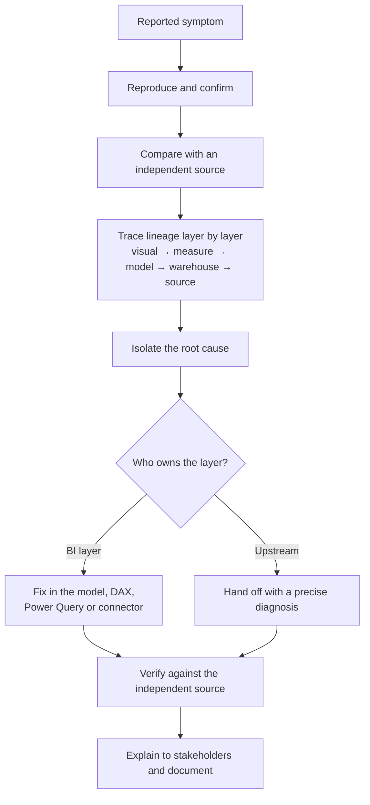

# Dashboard Root-Cause Analysis

*Finding out why a dashboard's numbers are wrong, and fixing the cause at the right layer, not the symptom in the report.*

**Project category:** Business Intelligence · Data Quality · Analytics Engineering  
**Project status:** Implemented — a series of investigations in 2026; most causes fixed, some fixes handed to data engineering  
**Primary focus:** Diagnosing wrong, missing and inflated figures in Power BI dashboards and tracing them to their source  
**Professional domain:** Automotive lending and insurance

> This case study describes a set of dashboard investigations I carried out for an automotive finance company and an insurance group. It is written for a public portfolio. Company, dashboard, table and ticket names, stakeholders and actual figures have intentionally been excluded.

## 1. Executive summary

When a dashboard shows the wrong number, the visible problem is in the report but the cause is usually somewhere upstream: a truncated table, a join at the wrong grain, a duplicate load, a filter that conflicts with an earlier fix. Patching the report hides the problem; it does not solve it.

Across a series of investigations, I traced wrong, missing and inflated dashboard figures back to their real causes in the warehouse, the data model, the DAX or the source process, and either fixed them or handed a precise diagnosis to the team that owned the layer. I also explained each finding to business stakeholders in plain language.

From this work I developed a repeatable approach:

**Symptom → reproduce → compare with an independent source → trace lineage layer by layer → isolate the cause → fix at the right layer (or hand off) → verify → explain to stakeholders**

## 2. Business context and problem

Business teams relied on Power BI dashboards for sales, lending, operations and compliance. When figures were wrong, trust in every dashboard suffered. The symptoms varied:

- Historical data missing from a dashboard.
- Several measures returning identical values when they should differ.
- Two dashboards disagreeing on the same count.
- User counts far higher than the web-analytics source.
- A dashboard crashing repeatedly.
- Records appearing that did not exist.
- A compliance report showing outdated status.

Each needed its cause found, not just its symptom patched.

## 3. Project objectives

1. Reproduce each reported problem and confirm it is real.
2. Find the root cause, wherever it sits in the pipeline.
3. Fix the cause at the correct layer, or hand a precise diagnosis to its owner.
4. Verify the fix against an independent source.
5. Explain findings and next steps to stakeholders clearly.
6. Document the investigation so the same problem is recognised quickly next time.

## 4. Scope

### In scope
- Power BI dashboards, data models, DAX measures and Power Query.
- Warehouse tables and views in BigQuery.
- Data connectors between Power BI and the warehouse.
- Source processes, including manually maintained spreadsheets.
- Root-cause documents, bug reports and stakeholder communications.

### Out of scope
- Rebuilding upstream warehouse tables owned by data engineering (handed off with a diagnosis).
- Changes to source operational systems.

## 5. Data and analytical considerations

| Area | Design consideration |
|---|---|
| Independent source | What trusted figure can the dashboard be compared with? |
| Lineage | Which tables, views and transformations sit between source and visual? |
| Grain | What does one row represent at each step, and can a join multiply it? |
| History | Do upstream tables keep full history, or are they truncated or filtered? |
| Load process | Are loads appended, replaced or chunked, and can they duplicate rows? |
| DAX context | Do filters or earlier fixes change what a measure calculates? |
| Source process | Is the source a system, or a manually maintained file? |

## 6. Analytical workflow



### 6.1 Reproduce and confirm
Every investigation starts by reproducing the problem and confirming exactly what is wrong, for which period and which slice.

### 6.2 Compare with an independent source
A trusted comparison, such as web analytics, a source system or another dashboard, shows how large the error is and in which direction.

### 6.3 Trace the lineage
I walk back from the visual through the measure, the data model, the warehouse tables and the source, checking the figure at each step until it changes.

### 6.4 Isolate the cause
The step where the figure goes wrong points to the cause: truncation, fan-out, duplicate loads, a filter conflict or a stale source.

### 6.5 Fix at the right layer
Problems in the BI layer I fixed directly. Problems in upstream tables went to data engineering with a precise diagnosis and a recommended fix.

### 6.6 Verify and explain
Each fix was checked against the independent source, and findings were explained to stakeholders in plain language, with what was wrong, why and what happens next.

## 7. Reporting and KPI framework

The investigations, in general terms:

| Symptom | Root cause found | Outcome |
|---|---|---|
| Historical records missing from a lending dashboard | Upstream warehouse tables truncated to recent history | Diagnosed and documented |
| All channel measures returning identical values | A DAX filter conflicting with an earlier interim fix | Diagnosed and documented |
| Two dashboards disagreeing on disbursed units | Six causes, including a distinct count over a table that stores two records per loan, join fan-out, hard-coded date floors and incorrect measure logic | Causes documented |
| User counts far above web analytics | Chunked appends writing duplicate partial-count rows | Diagnosed; table rebuild handed to data engineering |
| Dashboard crashing repeatedly | Database connector issue | Fixed by migrating to a newer connector |
| A regional filter could not be built | ID-based join ruled out at source | Built with dealer-name normalisation in Power Query |
| Phantom entries in an operations dashboard | ID collision between two versions of a source system | Root-cause document delivered |
| Outdated compliance status | A stale, manually maintained spreadsheet, not a dashboard defect | Traced to the source process |
| Paid claims missing from a customer view (insurance) | Records absent from the reporting layer of the pipeline | Bug report to data engineering |

No figures are stated. Actual values are confidential.

### Suggested management questions
- Is this number wrong, and by how much?
- Is the problem in the report, the data or the process?
- Who needs to fix it, and when will the number be right?
- Which other reports could be affected?

## 8. Data quality, validation and reconciliation

The checks I now apply to any dashboard:
1. **Independent comparison:** reconcile headline figures with a trusted source.
2. **Grain check:** confirm what one row represents before and after each join.
3. **Distinct-count check:** make sure the table does not store more than one row per entity.
4. **History check:** confirm upstream tables cover the full reporting period.
5. **Load check:** look for duplicate rows from appended or chunked loads.
6. **Filter check:** test measures with and without filters, especially after interim fixes.
7. **Source check:** confirm whether the source is a system or a manual file, and how fresh it is.

## 9. Technology and tools

| Technology / capability | Use in this work |
|---|---|
| Power BI | Dashboards under investigation |
| DAX | Measure logic and filter-context analysis |
| Power Query | Data shaping and dealer-name normalisation |
| BigQuery SQL | Warehouse investigation and lineage tracing |
| Web analytics | Independent source for user counts |
| Database connectors | Connector migration to resolve crashes |

## 10. My role and contribution

I carried out these investigations as a BI analyst and analytics engineer:
- Reproduced each problem and found its root cause.
- Fixed BI-layer causes directly: the connector migration and the regional filter.
- Wrote root-cause documents and technical bug reports for data engineering.
- Drafted stakeholder communications explaining each finding.

Upstream table rebuilds were carried out by data engineering colleagues, using my diagnoses.

## 11. Business value

- Wrong figures found and explained before they drove decisions.
- Fixes made at the cause, so problems did not return.
- Clear hand-offs to data engineering, with the evidence needed to act.
- Stakeholders kept informed in plain language.
- A repeatable approach that speeds up future investigations.

**Measured impact:** Not yet quantified. No time savings or accuracy figures are claimed.

## 12. Challenges and design risks

- **The symptom is rarely where the cause is.** Most causes sat upstream of the report.
- **Interim fixes create new problems.** One earlier fix introduced a filter conflict that made several measures identical.
- **Distinct counts are not always distinct.** A table holding two records per loan overcounted silently.
- **Not every problem is a data problem.** One compliance issue came from a stale manual spreadsheet.
- **Ownership.** Some fixes belonged to other teams and needed a clear, evidence-based hand-off.

## 13. Limitations and future enhancements

- Automated reconciliation of key dashboard figures against independent sources.
- Data tests on warehouse tables for history coverage, duplicates and grain.
- A shared log of past incidents and their causes.
- Monitoring of manual data sources for staleness.

## 14. Reproducibility and public demonstration

A synthetic demonstration is planned: a small fictional dataset with planted problems (a truncated table, a one-to-many join, a duplicate chunked load and a conflicting filter), the symptoms each produces in a dashboard, and the checks that find them.

```text
dashboard-root-cause-analysis/
├── README.md
├── docs/
│   ├── rca-playbook.md
│   └── rca-template.md
├── sample-data/
│   └── README.md
├── sql/                     # synthetic diagnostic queries
├── dax/                     # synthetic examples of the filter conflict and fix
└── .gitignore
```

## 15. Confidentiality and responsible disclosure

This write-up contains no:
- Company, dashboard, table, view or ticket names.
- Stakeholder or colleague names.
- Actual figures, counts or discrepancies.
- Customer, loan, vehicle or policy data.
- Screenshots from company systems.

## 16. Project information confirmed for publication

- [x] Investigations and their root causes, as described in our earlier chats.
- [x] Connector migration and regional filter implemented.
- [x] Upstream fixes handed to data engineering.
- [x] Publication approved for an anonymised case study.
- [ ] Which diagnosed issues have since been fixed.
- [ ] Measured impact, if any becomes available.
- [ ] Synthetic demonstration built and reviewed.

## 17. Conclusion

Root-cause analysis is where data engineering, BI and business understanding meet. A wrong number on a dashboard is a question about the whole pipeline, and answering it well means tracing it to the cause, fixing it in the right place and explaining it clearly.

My broader direction is to build dependable data products that connect engineering quality with meaningful business decisions, while deepening my capabilities in advanced analytics, data science and AI/ML engineering.

---

*Portfolio note: This is a sanitised case study. Company, system and people names and actual figures are withheld. Any demonstration data is synthetic.*
