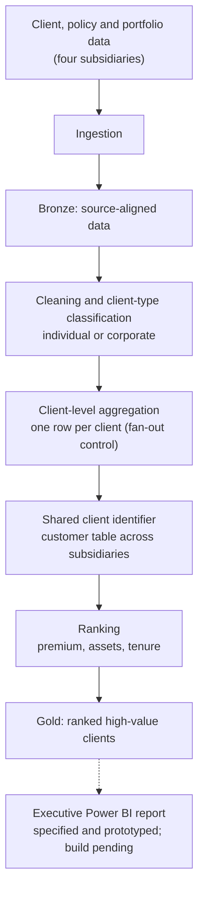

# High-Value Client Ranking Pipeline

*Ranking an insurance group's most valuable clients across its subsidiaries for executive management, and catching the join that multiplied their premiums.*

**Project category:** Data Engineering · Analytics Engineering · Customer Analytics  
**Project status:** Partially implemented: ranking pipelines built; executive Power BI report specified and prototyped, build pending  
**Primary focus:** Identifying and ranking high-value clients across general insurance, life, health and asset management, on reliable client-level figures  
**Professional domain:** Insurance and financial services

> This case study documents a client-ranking pipeline built for the top executive management of a multi-line insurance group. It is written for a public portfolio. Company names, client data, internal table and field names, actual figures and proprietary ranking rules have intentionally been excluded.

## 1. Executive summary

The High-Value Client Ranking Pipeline identifies and ranks an insurance group's most valuable clients, so executive management can see who they are, what they hold and how much they contribute across the group.

I built ranking pipelines for four subsidiaries: general insurance, life, health and asset management. Each pipeline brings client, policy and portfolio data together, classifies clients correctly as individuals or corporates, and ranks them on premium, assets and tenure. The ranked output covers over a thousand clients.

The most important moment came during the build. A join to a portfolio table matched each client to many rows, which multiplied premiums many times over. Had it gone unnoticed, the ranking would have put the wrong clients at the top. Fixing it, and adding checks so it cannot happen silently again, is the core of this case study.

The analytical workflow:

**Subsidiary source data → ingestion → cleaning and client-type classification → client-level aggregation (fan-out control) → shared client identifier across subsidiaries → ranking on premium, assets and tenure → ranked output → executive reporting (specified and prototyped)**

## 2. Business context and problem

A multi-line insurance group serves the same clients through several subsidiaries, and each subsidiary keeps its own records. Executive management wanted a clear answer to a simple question: who are our most valuable clients?

Answering it reliably raised several problems:

- **No group-wide view.** A client holding insurance in one subsidiary and investments in another appeared as two unrelated records.
- **Different measures of value.** Insurance businesses measure clients by premium; an asset manager measures them by assets. A fair ranking had to bring both together, along with how long the client has stayed.
- **Misclassified clients.** Rules that labelled clients as individuals or corporates from their names were classifying some clients incorrectly, distorting both segments.
- **Inflated figures.** A one-to-many join to portfolio data multiplied premium totals. Rankings built on those figures would be wrong at exactly the top of the list, where executives look first.

The goal was a ranked list of high-value clients that executives could trust, built on figures at the correct client level.

## 3. Project objectives

1. Build a client-ranking pipeline for each of four subsidiaries.
2. Classify clients correctly as individuals or corporates.
3. Calculate each client's value at the correct grain: one row per client.
4. Rank clients on premium, assets and tenure.
5. Link clients across subsidiaries with a shared identifier, for a group-wide view.
6. Specify and prototype an executive Power BI report on the ranked output.
7. Prepare for a combined report covering the group's main entities.

## 4. Scope

### In scope
- Client, policy and portfolio data for general insurance, life, health and asset management.
- Client-type classification (individual or corporate).
- Client-level aggregation of premium, assets and tenure.
- Ranking of high-value clients within each subsidiary.
- A shared client identifier and a customer table that links clients across subsidiaries.
- A Power BI build specification and an interactive HTML prototype for executives.

### Out of scope unless separately confirmed
- A built and deployed Power BI report (specified and prototyped only).
- Client profitability, claims cost or lifetime-value modelling.
- Predictive models such as churn or propensity scoring.
- Automated client outreach or CRM integration.
- The pensions entity, planned for a later combined report.

## 5. Data and analytical considerations

The pipelines use client, policy, premium and portfolio data from each subsidiary. Source systems, table names and field definitions are internal and are not published.

| Area | Design consideration |
|---|---|
| Client grain | One row per client before ranking. Which key identifies a client within each subsidiary? |
| Cross-subsidiary identity | Which shared identifier links the same client across subsidiaries? |
| Client type | How are individuals and corporates told apart reliably? |
| Premium | Which premium figure represents a client's value, and over what period? |
| Assets | Which portfolio value represents a client's investments, and at what date? |
| Tenure | Which date marks the start of the client relationship? |
| Portfolio join | How many portfolio rows can one client have, and how are they brought to client level before joining? |
| Ranking | How are premium, assets and tenure combined into one ranking? |

The ranking weights and thresholds are internal and are not published.

## 6. Analytical workflow

The pipeline as built:



### 6.1 Ingestion and source alignment
Client, policy and portfolio data from each subsidiary were brought into the platform in PySpark, keeping each record's source subsidiary so results can be traced back.

### 6.2 Bronze layer — source-aligned data
Source data is held with minimal change, as the starting point for transformation and for investigating any figure that looks wrong.

### 6.3 Cleaning and client-type classification
Client records are standardised, and each client is classified as an individual or a corporate. The original classification rules, based on name patterns, were labelling some clients incorrectly. I corrected the rules so each segment contains the right clients.

### 6.4 Client-level aggregation and the fan-out fix
This is where the main issue was found and fixed.

**The problem.** The portfolio data holds more than one row per client. Joining it directly to client-level premium matched each client to many portfolio rows, and every match repeated the client's premium. Premium totals came out many times higher than they should have been.

**The fix.** Each client now matches exactly one record at the join: portfolio data is brought to one row per client before it is joined. Row counts and premium totals are compared before and after each join, so any future fan-out shows up at once rather than in an executive report.

### 6.5 Shared client identifier
A customer table assigns each client a shared identifier across subsidiaries, so a single lookup returns a client's full picture across the group.

### 6.6 Ranking, Gold output and reporting
Clients are ranked on premium, assets and tenure. The ranked output is stored in the Gold layer in Delta Lake. I wrote a Power BI build specification and built an interactive HTML prototype of the executive report. The Power BI report itself has not yet been built.

## 7. Reporting and KPI framework

The ranked dataset is designed to support these views. Their values are internal and are not published.

| KPI / analytical view | Purpose | Definition |
|---|---|---|
| High-value client list | Identify the most valuable clients | Clients ranked on premium, assets and tenure |
| Client premium | Insurance value per client | Premium at client level, after fan-out control |
| Client assets | Investment value per client | Portfolio value at client level |
| Client tenure | Relationship length | Time since the client relationship began |
| Premium concentration | Dependence on top clients | Share of total premium from the top-ranked clients |
| Cross-subsidiary holdings | Group relationship depth | Clients holding products in more than one subsidiary |
| Segment mix | Individual versus corporate | Ranked clients by client type |
| Data-quality exceptions | Pipeline health | Unmatched, duplicate and unclassified clients |

### Suggested management questions
The ranking helps executives answer:
- Who are our most valuable clients, in each subsidiary and across the group?
- How much of our premium depends on a small number of clients?
- Which high-value clients hold products in only one subsidiary, and could be served more widely?
- How are high-value clients split between individuals and corporates?
- How long have our most valuable clients been with us?

No numerical results are stated. Actual figures are confidential.

## 8. Data quality, validation and reconciliation

Rankings are only as good as the figures underneath them. The pipelines apply these checks:

1. **Grain check:** one row per client before ranking.
2. **Join cardinality check:** row counts are compared before and after each join; an unexpected increase signals fan-out.
3. **Premium reconciliation:** premium totals after joining must equal premium totals before joining.
4. **Classification check:** client-type labels are reviewed against known individual and corporate clients.
5. **Duplicate check:** a client must not appear twice within a subsidiary.
6. **Identifier match check:** clients that cannot be linked across subsidiaries are counted and reviewed.
7. **Type check:** key and amount fields are cast to their expected types before filtering and joining.

The lesson: a pipeline can run without errors and still produce figures many times too large. Only reconciling totals before and after each join exposes it.

## 9. Technology and tools

| Technology / capability | Use in this project |
|---|---|
| PySpark | Ingestion, cleaning, classification, aggregation and ranking |
| Databricks | Development and execution of the pipelines |
| Microsoft Fabric | Lakehouse platform for the data and outputs |
| Delta Lake | Storage for the layered and ranked tables |
| Power BI | Executive report, specified for build |
| HTML | Interactive prototype of the executive report |

## 10. My role and contribution

My role is Senior Data Analytics Engineer, after several years in FP&A and financial reporting. I built this project for top executive management.

My contribution:
- Built the ranking pipelines for four subsidiaries in PySpark.
- Found and fixed the join fan-out that inflated premiums, and added the checks that now catch it.
- Corrected the client-type classification rules.
- Designed the Gold-layer output for the ranked clients.
- Helped create the customer table that links clients across subsidiaries.
- Wrote the Power BI build specification and built the interactive HTML prototype.

**Related work:** I also built retail customer KPI scorecards that use the same corrected classification rules and fan-out controls.

## 11. Business value

The project gives executive management:
- A ranked view of the group's most valuable clients, built on correct client-level figures.
- A fair ranking that combines insurance premium, investment assets and tenure.
- Correct individual and corporate segments.
- A group-wide view of clients across subsidiaries, as a basis for cross-selling and relationship management.
- Protection against inflated figures reaching executive reports.

**Measured impact:** Not yet quantified in the material available for this public case study. No revenue, retention or efficiency figures are claimed.

## 12. Challenges and design risks

Challenges met and addressed in this project:
- **Join fan-out.** A one-to-many join multiplied premiums many times over. The fix was to bring data to client grain before joining and to reconcile totals before and after.
- **Name-based classification.** Pattern rules for telling individuals from corporates misclassified some clients. Corrected rules and a review against known clients fixed this.
- **Different value measures.** Premium and assets are not directly comparable, so the ranking had to combine them deliberately rather than add them together.
- **Client identity across subsidiaries.** Each subsidiary identifies clients in its own way; a shared identifier was needed for a group-wide view.
- **Silent type issues.** In related work, a ledger-code field stored as a decimal number made a membership filter fail silently. Casting types before filtering is now standard.

## 13. Limitations and future enhancements

Current limitations and possible enhancements:
- **Power BI report.** The executive report is specified and prototyped but not yet built.
- **Combined group report.** A single report covering general insurance, life, health, asset management and pensions is in development.
- **Ranking refresh.** Scheduled refreshes with ranking-movement tracking would show which clients are rising or falling.
- **Richer value measures.** Claims cost and profitability would give a fuller view of client value.
- **Cross-selling analysis.** Using cross-subsidiary holdings to identify relationship opportunities.

These are recommendations, not completed functionality.

## 14. Reproducibility and public demonstration

This public case study does not include client data, proprietary source code or confidential ranking rules.

A synthetic demonstration is planned. It will use fictional clients across four fictional subsidiaries and include a deliberately one-to-many portfolio table. It will show the inflated totals a direct join produces, the client-level fix, the before-and-after reconciliation that proves it, and a simple ranking on premium, assets and tenure. The data will be labelled synthetic and must not be read as real client information.

```text
high-value-client-ranking/
├── README.md
├── docs/
│   ├── ranking-approach.md
│   └── fan-out-explained.md
├── diagrams/
│   └── data-flow.mmd
├── sample-data/
│   └── README.md
├── notebooks/              # synthetic demonstration only
├── src/                    # sanitised, reusable transformation logic
├── tests/                  # grain, fan-out and reconciliation checks
└── .gitignore
```

Only files with useful, reviewed content will be created. No client extracts, production notebooks, connection details or internal screenshots will be uploaded.

## 15. Confidentiality and responsible disclosure

This write-up is intentionally generalised for public use. It contains no:
- Client names, contact details, policy numbers or identifiers.
- Actual premiums, assets, client counts or ranking results.
- Ranking weights, thresholds or proprietary business rules.
- Internal system, database, table, field, workspace or storage names.
- Credentials, access tokens or connection strings.
- Screenshots or extracts from company systems.

Any public demonstration uses synthetic data and recreated diagrams.

## 16. Project information confirmed for publication

- [x] Project title and public description.
- [x] Timeframe: 2026.
- [x] Status: ranking pipelines built; Power BI report specified and prototyped, not yet built.
- [x] Subsidiaries covered: general insurance, life, health and asset management.
- [x] Ranking measures: premium, assets and tenure.
- [x] Audience: top executive management.
- [x] Fan-out issue and fix described in general terms; exact figures kept private.
- [x] Publication approved for an anonymised case study.
- [ ] Exact fan-out fix method (aggregation or de-duplication before the join).
- [ ] Your role in the cross-subsidiary customer table.
- [ ] Power BI report built.
- [ ] Measured business impact, if any becomes available.
- [ ] Synthetic demonstration built and reviewed.

## 17. Conclusion

The High-Value Client Ranking Pipeline shows the kind of problem I care most about: numbers that look right but aren't. A join that silently multiplies premium is invisible in code and obvious only when totals are reconciled. My finance background makes that reconciliation a habit, not an afterthought.

The project combines data engineering, customer analytics and executive reporting, and it gives leadership a ranking they can trust because every figure underneath it has been checked.

My broader direction is to build dependable data products that connect engineering quality with meaningful business decisions, while deepening my capabilities in advanced analytics, data science and AI/ML engineering.

---

*Portfolio note: This is a sanitised case study. Client data, figures, internal names and ranking rules are withheld. Any demonstration data is synthetic.*
