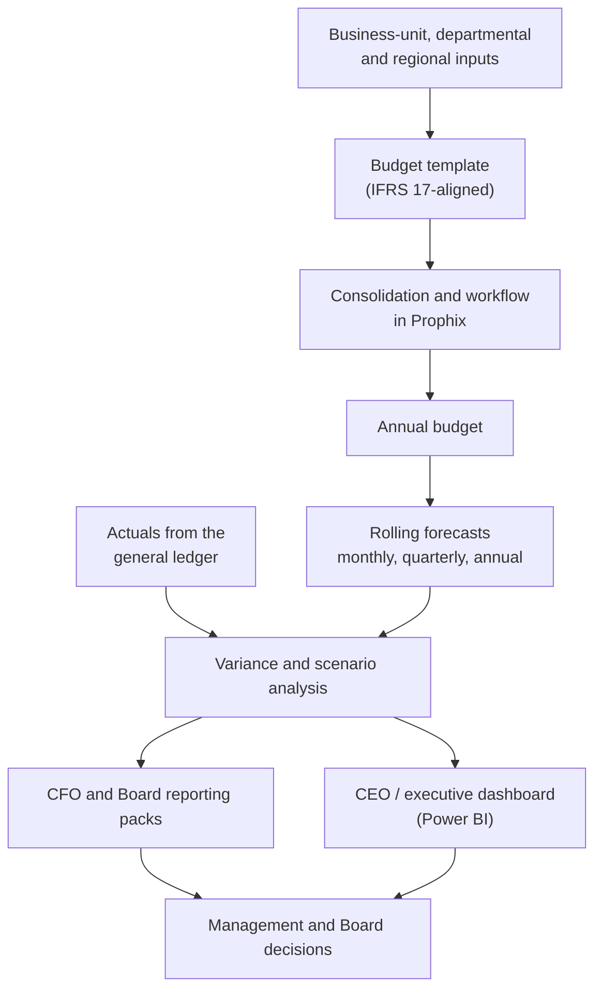

# Insurance Budgeting, Forecasting & Board Reporting

*Running the planning and performance-reporting cycle of a multi-line insurer, from the annual budget to the Board pack.*

**Project category:** Financial Planning & Analysis · Executive Reporting · Business Intelligence  
**Project status:** Recurring responsibility — Lead, Financial Planning & Reporting (April 2022 – December 2024)  
**Primary focus:** Annual budgeting, rolling forecasts, variance and scenario analysis, CFO/Board reporting and executive dashboards  
**Professional domain:** Insurance and financial services

> This case study describes the financial planning and reporting cycle I led at a multi-line insurance group. It is written for a public portfolio. Company names, actual financial results, budgets, internal models and board material have intentionally been excluded. Any demonstration uses a fictional insurer and synthetic data.

## 1. Executive summary

For almost three years I led financial planning and reporting for a multi-line insurance group. The role covered the full cycle: building the annual budget with business units, forecasting monthly, quarterly and annually, explaining the variances, modelling scenarios, and turning all of it into CFO and Board reporting packs and an executive dashboard.

Two things made the work more than a reporting routine. I led the automation of budgeting and reporting workflows in Prophix, and I built a budget template aligned to the group's IFRS 17 budget model, so planning stayed consistent with the new insurance accounting standard.

This is the foundation of my move into data engineering. Years of reconciling, explaining and defending numbers to a CFO and a Board taught me what decision-makers need from data, and why figures must be right before they are presented.

The planning and reporting cycle:

**Business-unit inputs → budget template (IFRS 17-aligned) → consolidation in Prophix → rolling forecasts → actuals from the general ledger → variance and scenario analysis → CFO and Board packs and executive dashboard → management decisions**

## 2. Business context and problem

An insurance group plans across several businesses, departments and regions, each with its own drivers and assumptions. Leadership needs one consistent plan, an early view of where results are heading, and a clear explanation of why actual performance differs from the plan.

Without a disciplined cycle, common problems appear:
- Budgets built in disconnected spreadsheets that are hard to consolidate.
- Forecasts that are updated late or inconsistently across business units.
- Variances reported without a clear explanation of what drove them.
- Planning that does not line up with the accounting basis used to report results, which became critical with IFRS 17.
- Manual, repetitive preparation of reporting packs every month.

My role was to make the cycle consistent, timely and decision-ready.

## 3. Project objectives

1. Deliver the annual budget, aligned with corporate goals, with business, departmental and regional stakeholders.
2. Maintain monthly, quarterly and annual forecasts of financial performance.
3. Explain variances between budget, forecast and actual results.
4. Model scenarios to support strategic decisions.
5. Produce CFO and Board reporting packs with clear recommendations.
6. Track enterprise KPIs and strategic performance in an executive dashboard.
7. Automate budgeting and reporting workflows to reduce manual effort.
8. Keep budgeting consistent with the group's IFRS 17 budget model.

## 4. Scope

### In scope
- Annual budget cycle across business units, departments and regions.
- Monthly, quarterly and annual forecasting.
- Budget-versus-actual and variance analysis.
- Financial modelling and scenario analysis.
- CFO and Board reporting packs.
- The CEO / executive dashboard in Power BI.
- Enterprise KPI and strategic performance reporting.
- Expense analysis, general-ledger review and peer benchmarking.
- Prophix automation of budgeting and reporting workflows.
- A budget template aligned to the IFRS 17 budget model.

### Out of scope
- Statutory financial statements and audit.
- Actuarial reserving and the IFRS 17 measurement model itself.
- Investment management decisions.

## 5. Data and analytical considerations

| Area | Design consideration |
|---|---|
| Budget inputs | How are business-unit, departmental and regional assumptions collected consistently? |
| Consolidation | How do individual budgets roll up into one group plan? |
| Actuals | Which general-ledger accounts and periods feed the actual figures? |
| Forecast cadence | How often is each forecast updated, and from which inputs? |
| Variance drivers | How is a variance split into volume, price, timing and one-off effects? |
| Scenarios | Which assumptions change in each scenario, and by how much? |
| IFRS 17 alignment | How does the budget template map to the IFRS 17 budget model? |
| KPIs | Which enterprise KPIs measure progress against strategy? |

## 6. Analytical workflow



### 6.1 Budget preparation
I ran the annual budget cycle with business, departmental and regional stakeholders, aligning their plans with corporate goals. I built a budget template aligned to the group's IFRS 17 budget model, so every unit planned on the same basis.

### 6.2 Consolidation and automation
I led the automation of budgeting and reporting workflows in Prophix, replacing manual consolidation steps with a structured planning process.

### 6.3 Forecasting
Forecasts were updated monthly, quarterly and annually, giving leadership an early view of where results were heading against the budget.

### 6.4 Variance and scenario analysis
Actual results from the general ledger were compared with budget and forecast. Variances were explained by their drivers, and scenario models tested the effect of changing assumptions on strategic decisions. Expense analysis and general-ledger reviews kept the underlying figures reliable.

### 6.5 Executive reporting
I prepared CFO and Board reporting packs with variance commentary and strategic recommendations, and built and maintained the CEO / executive dashboard in Power BI for ongoing KPI tracking.

### 6.6 Benchmarking and ad hoc analysis
Peer benchmarking and ad hoc financial and non-financial analysis put the group's performance in context and answered questions as they arose.

## 7. Reporting and KPI framework

The packs and dashboard tracked enterprise KPIs and strategic performance against budget. The actual KPI set and results are internal. A public demonstration would use measures such as:

| KPI / analytical view | Purpose | Definition |
|---|---|---|
| Premium versus budget | Track top-line delivery | Actual premium against budgeted premium, by business |
| Forecast versus budget | Early warning | Latest forecast against the annual budget |
| Expense versus budget | Cost control | Actual expenses against budgeted expenses, by department |
| Variance by driver | Explain performance | Variance split into volume, price, timing and one-off effects |
| Scenario outcomes | Support decisions | Projected results under each scenario |
| Peer comparison | Context | Selected measures against published peer results |

### Suggested management questions
- Are we on track to deliver the annual budget, and if not, why?
- Which businesses, departments or regions are driving the variance?
- What does the latest forecast say about the year-end position?
- How would results change under different assumptions?
- How do we compare with our peers?

No numerical results are stated. Actual figures are confidential.

## 8. Data quality, validation and reconciliation

Board-level numbers have to survive challenge. The checks I applied:

1. **Ledger reconciliation:** actuals agree with the general ledger before analysis.
2. **Consolidation check:** business-unit budgets add up to the group plan.
3. **Template consistency:** every unit plans on the same IFRS 17-aligned template.
4. **Variance completeness:** every material variance has an explanation.
5. **Expense and ledger review:** unusual postings and trends are investigated.
6. **Version control:** each forecast round is kept separately, so changes can be traced.

## 9. Technology and tools

| Technology / capability | Use in this work |
|---|---|
| Excel | Financial models, budget templates, scenario analysis and packs |
| Prophix | Budgeting and reporting workflows and their automation |
| Power BI | CEO / executive dashboard |

## 10. My role and contribution

I was Lead, Financial Planning & Reporting Analyst from April 2022 to December 2024. Before that I spent eight years as a financial analyst and payment analyst: reconciliations, cash-flow reporting, payment processing and ledger postings.

In this role I:
- Led the annual budget cycle with business, departmental and regional stakeholders.
- Produced monthly, quarterly and annual forecasts.
- Prepared CFO and Board reporting packs, variance analysis and recommendations.
- Built financial models and scenario analyses.
- Built and maintained the CEO / executive dashboard in Power BI.
- Led the automation of budgeting and reporting workflows in Prophix.
- Built a budget template aligned to the IFRS 17 budget model.
- Carried out expense analysis, general-ledger reviews and peer benchmarking.

## 11. Business value

- One consistent group budget aligned with corporate goals.
- Regular forecasts that gave leadership an early view of results.
- Clear, explained variances in CFO and Board reporting.
- Scenario analysis to support strategic decisions.
- Less manual effort through Prophix automation.
- Budgeting kept consistent with IFRS 17.

**Measured impact:** Not yet quantified in the material available for this public case study. No time savings or accuracy figures are claimed.

## 12. Challenges and design risks

- **Many contributors, one plan.** Collecting consistent inputs from many units required a common template and a clear timetable.
- **New accounting standard.** IFRS 17 changed how insurance results are measured, so budgets had to be aligned to the IFRS 17 budget model.
- **Explaining, not just reporting.** Boards want to know why results moved. Variance analysis had to identify drivers, not only differences.
- **Manual effort.** Repetitive consolidation and pack preparation were candidates for automation in Prophix.

## 13. Limitations and future enhancements

What I would do with today's data engineering skills:
- Feed actuals from the ledger through an automated pipeline instead of manual extracts.
- Store budgets, forecasts and actuals in one model, so every report reads from the same source.
- Add automated reconciliation checks before each pack is produced.
- Use statistical forecasting alongside driver-based forecasts.

## 14. Reproducibility and public demonstration

A synthetic demonstration is planned for a fictional insurer: budget, forecast and actuals by business and month, a variance analysis that splits differences by driver, a simple scenario model, and an executive summary page. All data will be fictional and labelled as such.

```text
insurance-budgeting-forecasting/
├── README.md
├── docs/
│   ├── planning-cycle.md
│   └── variance-method.md
├── sample-data/
│   └── README.md            # how the fictional insurer's data is generated
├── model/                   # synthetic budget, forecast and variance workbook
├── dashboard/               # screenshots of a dashboard built on synthetic data
└── .gitignore
```

## 15. Confidentiality and responsible disclosure

This write-up contains no:
- Actual budgets, forecasts, results or KPIs.
- Board or CFO reporting material.
- Internal models, templates or Prophix configuration.
- Employee, customer or policyholder information.
- Screenshots from company systems.

## 16. Project information confirmed for publication

- [x] Role and dates: Lead, Financial Planning & Reporting, April 2022 – December 2024.
- [x] Scope of responsibilities, from the CV.
- [x] CEO / executive dashboard built and maintained in Power BI.
- [x] Prophix automation of budgeting and reporting workflows, which I led.
- [x] Budget template aligned to the IFRS 17 budget model.
- [x] Publication approved for an anonymised case study.
- [ ] What specifically the Prophix automation replaced (before and after).
- [ ] Measured impact, such as reporting time saved.
- [ ] Synthetic demonstration built and reviewed.

## 17. Conclusion

This is where my career in data started. Leading budgeting, forecasting and Board reporting taught me what decision-makers need from numbers: consistency, timeliness and a clear explanation of what changed.

I now build the data pipelines and BI products that serve that need. My finance background is why I treat reconciliation as part of engineering, not an afterthought.

My broader direction is to build dependable data products that connect engineering quality with meaningful business decisions, while deepening my capabilities in advanced analytics, data science and AI/ML engineering.

---

*Portfolio note: This is a sanitised case study. No actual financial information is disclosed. Any demonstration data is fictional.*
