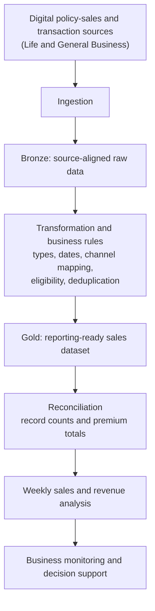

# Insurance Sales-to-Revenue Reconciliation Pipeline

*Turning digital policy sales into finance-reconciled revenue data for Life and General Business, from raw source to production.*

**Project category:** Data Engineering · Analytics Engineering · Revenue Reconciliation  
**Project status:** Implemented — delivered to production in 2026  
**Primary focus:** Digital-channel policy sales, premium/revenue realisation and weekly business performance monitoring for Life and General Business  
**Professional domain:** Insurance and financial services

> This case study documents a production analytics pipeline that brings digital-channel policy sales and their associated premium into one reconciled, reporting-ready view. It is written for a public portfolio. Internal system names, storage paths, credentials, customer information, actual figures and proprietary business rules have intentionally been excluded.

## 1. Executive summary

The Insurance Sales-to-Revenue Reconciliation Pipeline is a data engineering and analytics project that brings digital policy-sales activity for Life Business and General Business, and its associated premium, into one consistent analytical dataset.

The project delivered a production pipeline on Microsoft Fabric and Databricks. It lands source sales and transaction data, applies agreed business rules, reconciles record counts and premium, and produces a reporting-ready sales dataset that supports weekly analysis of policy purchases and revenue by digital channel.

The analytical workflow follows a layered data-processing approach:

**Source data → ingestion into a raw (Bronze) layer → transformation and business-rule application → reconciliation of counts and premium → reporting-ready (Gold) sales dataset → weekly sales and revenue analysis**

I led delivery. I made the source data available, supervised the data analyst who built the transformations, and pushed the pipeline to production. My background as an FP&A and financial reporting lead shaped the focus on reconciliation: sales numbers are only useful if they agree with what finance recognises.

## 2. Business context and problem

Digital distribution channels create policy-sales activity across different systems and transaction records. Before this project, sales and premium information was not brought together consistently, which created familiar challenges:

- No single, consolidated view of digital policy purchases for Life and General Business.
- Difficulty comparing sales activity and premium contribution across digital channels.
- Inconsistent week-to-week monitoring, because different extracts used different dates and rules.
- Policy-sales records that were hard to reconcile with the related premium information.
- Channel values recorded under different codes or spellings across sources.
- Duplicated, ineligible or stale records that could reach reports unnoticed.

The project addressed the need for one reliable, repeatable source of digital sales and revenue data, so that operations, sales and finance work from the same numbers.

## 3. Project objectives

1. Consolidate digital policy-sales activity for Life and General Business into one analytical structure.
2. Establish consistent transformation and business rules for the sales dataset.
3. Associate each policy purchase with the correct premium information.
4. Apply data-quality checks and reconcile counts and premium before the data is used.
5. Enable weekly analysis of policy purchases and revenue performance.
6. Support channel-level comparison and business performance monitoring.
7. Deliver the pipeline to production as a repeatable foundation for reporting.

## 4. Scope

### In scope
- Digital-channel policy-purchase activity for Life Business and General Business.
- Premium/revenue associated with eligible policy transactions.
- Ingestion of source records into a raw (Bronze) layer.
- Channel classification and standardisation.
- Eligibility rules: reporting start date, positive premium, qualifying records.
- Deduplication and latest-transaction-date checks.
- A reporting-ready (Gold) sales dataset.
- Record-count and premium reconciliation.
- Production deployment on Microsoft Fabric and Databricks.

### Out of scope
- Sales through non-digital channels.
- End-to-end policy administration or underwriting automation.
- Financial-statement revenue recognition, including IFRS 17.
- Real-time streaming or real-time dashboard availability.
- Forecasting, attribution modelling or predictive analytics.

## 5. Data and analytical considerations

The project uses policy-sales and transaction data from digital distribution processes for Life and General Business. Source systems, table names and field-level definitions are internal and are not published.

The following decisions were agreed before transformation began. The approved answers are internal, so they are listed here as questions only.

| Area | Design consideration |
|---|---|
| Sales event | Which record represents a completed digital policy purchase? |
| Transaction grain | Is the analytical record at policy, transaction or payment level? |
| Channel | How is the originating digital channel identified and mapped to an agreed list? |
| Revenue/premium | Which authoritative record supplies the amount used in reporting? |
| Dates | Which date drives weekly reporting, and from which start date is data in scope? |
| Duplicates | Which key identifies a duplicate or repeated source record? |
| Eligibility | Which records and premium amounts qualify for inclusion? |
| Reconciliation | Which control totals validate the analytical output? |

## 6. Analytical workflow

The pipeline as delivered:



### 6.1 Ingestion and source alignment
I owned this step. Source sales and transaction records were brought into the platform with their origin and load timing preserved, so every downstream figure can be traced back to its source.

### 6.2 Bronze layer — source-aligned data
The Bronze layer holds ingested source data with minimal change. It is the traceable starting point for transformation and for investigating any number that looks wrong.

### 6.3 Transformation and standardisation
A data analyst built the transformation logic under my supervision. It applies:
- Data-type standardisation.
- Date parsing and normalisation.
- Channel classification against an agreed channel list.
- A reporting start date, so only in-scope transactions are included.
- A positive-premium filter, so reversals and zero-value records do not distort revenue.
- Deduplication on an agreed business key.
- A latest-transaction-date check, so stale loads are caught.

These rules run in the step that builds the Gold dataset. There is no separate Silver layer (see §13).

### 6.4 Business rules and sales dataset
The sales dataset was built at an explicit grain, so that joining policy activity to premium information does not duplicate or inflate amounts.

Key design controls:
- Define the business grain before joining datasets.
- Use agreed business keys.
- Avoid many-to-many joins that multiply transaction values.
- Apply channel mappings consistently across Life and General Business.
- Preserve lineage, so reported values can be traced to source.

### 6.5 Gold / reporting-ready layer
The Gold dataset exposes validated, business-oriented fields for reporting and weekly analysis. I reviewed it and pushed it to production on Microsoft Fabric and Databricks.

### 6.6 Power BI and reporting
The Gold dataset supports weekly visibility of digital policy purchases and premium. A related General Business weekly sales dashboard, which I maintain in Power BI, covers the same sales domain but was a separate deliverable.

## 7. Reporting and KPI framework

The dataset is designed to support these measures. Their values are internal and are not published.

| KPI / analytical view | Purpose | Definition |
|---|---|---|
| Policy purchases | Monitor digital sales volume | Count of eligible policy-purchase events or distinct policies |
| Revenue / premium | Monitor financial contribution | Approved premium amount from the authoritative source |
| Weekly policy purchases | Track sales movement over time | Purchases per week on the agreed business date |
| Weekly revenue / premium | Track revenue movement over time | Premium per week on the agreed business date |
| Channel contribution | Compare channel performance | Share of purchases and premium by standardised channel |
| Average premium per policy | Understand average value | Premium ÷ eligible policy count |
| Realisation rate | Track how much sold premium is realised | Realised premium ÷ premium on policies sold, for the same cohort |
| Reconciliation variance | Compare analytical totals with control totals | Dataset total − control total |
| Data-quality exceptions | Monitor reliability | Count of duplicate, unmapped, ineligible and stale records |

### Suggested management questions
The dataset helps stakeholders answer:
- How many eligible policies were purchased through digital channels this week, for Life and for General Business?
- How did weekly policy purchases change compared with the previous week?
- What premium is associated with those purchases, and how much of it has been realised?
- Which digital channels contribute most to policy purchases and revenue?
- Are sales volumes and premium moving in the same direction?
- Do the reported totals agree with the control totals?
- Which records were excluded or flagged, and why?

No numerical results are stated. Actual figures are confidential.

## 8. Data quality, validation and reconciliation

Reliable revenue reporting depends on validating both the sales records and the premium associated with them. The pipeline applies these checks:

1. **Type validation:** fields are cast to their expected data types.
2. **Date validation:** business dates are parsed correctly and fall within the reporting period.
3. **Reporting-period filter:** only transactions from the agreed start date are included.
4. **Premium validation:** only positive premium amounts are included.
5. **Duplicate checks:** duplicate records are removed on the agreed business key.
6. **Channel validation:** channel values map to the agreed reporting categories.
7. **Freshness check:** the latest transaction date is checked, so stale loads are caught.
8. **Join control:** joins are made at the declared grain to prevent row multiplication.
9. **Reconciliation:** record counts and premium totals are reconciled before the data is used.

A technically successful pipeline is not sufficient evidence that reported revenue is correct. The output has to agree with an authoritative control total, using consistent dates, rules and definitions.

## 9. Technology and tools

| Technology / capability | Use in this project |
|---|---|
| Microsoft Fabric | Production data platform (Lakehouse, OneLake) |
| Databricks | Production data platform; implementation also compared with Fabric |
| PySpark | Ingestion, transformation and business-rule processing |
| Delta Lake | Table storage for the Bronze and Gold layers |
| Bronze / Gold layering | Layered data organisation from raw to reporting-ready |
| SQL | Data investigation, querying and reconciliation |
| Power BI | Related weekly sales reporting |

## 10. My role and contribution

My role is Senior Data Analytics Engineer. Before that I spent several years in financial planning, reporting and business analysis, which shapes how I approach revenue data.

On this project I led delivery:
- Understood the business requirement for digital policy-sales and premium reporting across Life and General Business.
- Made the source data available by landing it in the raw (Bronze) layer.
- Agreed the business rules and kept the end-to-end process on track.
- Supervised and reviewed the transformation work that produced the Gold sales dataset.
- Ensured counts and premium were reconciled before the data was used.
- Pushed the pipeline to production on Microsoft Fabric and Databricks.

A data analyst built the transformation and business-rule logic under my supervision. A senior business stakeholder sponsored the project.

## 11. Business value

The project delivered:
- One consistent, reporting-ready view of digital policy purchases and premium for Life and General Business.
- A single, agreed definition of a sale and of premium, instead of conflicting extracts.
- Weekly monitoring of digital sales and channel performance from the same source.
- Reconciliation built into the pipeline rather than done by hand afterwards.
- Earlier detection of duplicate, ineligible and stale records.
- A production foundation that other reports can build on.

**Measured impact:** Not yet quantified in the material available for this public case study. No time savings, revenue uplift or accuracy figures are claimed.

## 12. Challenges and design risks

Challenges addressed in this project and in closely related work:
- **Different representations of a sale.** Sales, policy and payment events are recorded differently across sources. Agreeing the sales event and grain before building avoided mismatched totals.
- **Purchase date versus payment date.** The date that places a sale in a week had to be agreed, or weekly figures could not be reconciled.
- **Inconsistent channel values.** Raw channel values needed mapping to an agreed list before any channel comparison was meaningful.
- **Join fan-out.** In an earlier customer-ranking project of mine, a one-to-many join to a portfolio table multiplied premiums. Joining at a declared grain is the control used here.
- **Silent type errors.** In the related weekly sales dashboard, text-versus-integer mismatches in weekly measures produced wrong results without any error. Enforcing types early in the pipeline prevents this.
- **Coordinating delivery.** Making the data available on time, keeping the analyst's work aligned to the agreed rules and deploying safely to two platforms was as much of the job as the transformations.

## 13. Limitations and future enhancements

Current limitations and possible enhancements:
- **Separate Silver layer.** Cleaning and business rules run in the Gold build step. Moving them into a reusable Silver layer would let other reports share the same cleaned data.
- **Automated alerts.** Reconciliation is checked; automated exception alerts and a standing reconciliation report would surface problems sooner.
- **Documentation.** A published KPI dictionary and business-rule catalogue would help new analysts.
- **Dedicated reporting.** A Power BI semantic model built directly on the Gold dataset.
- **Deeper analysis.** Year-on-year trends, product segmentation and, once enough history exists, forecasting.

These are recommendations, not completed functionality.

## 14. Reproducibility and public demonstration

This public case study does not include internal company data, proprietary source code or confidential business rules.

A synthetic demonstration is planned. It will use fictional policy references, channels, dates and premiums, and will show raw data → transformation → Gold sales dataset → reconciliation end to end, including a deliberate duplicate, an unmapped channel and a fan-out join, each caught by a check. The sample will be labelled synthetic and must not be read as actual company performance.

```text
insurance-sales-revenue-pipeline/
├── README.md
├── docs/
│   ├── business-rules-template.md
│   ├── kpi-dictionary-template.md
│   └── architecture.md
├── diagrams/
│   └── data-flow.mmd
├── sample-data/
│   └── README.md
├── notebooks/              # synthetic demonstration only
├── src/                    # sanitised, reusable transformation logic
└── .gitignore
```

Only files with useful, reviewed content will be created. No company extracts, production notebooks, connection details, storage paths or internal screenshots will be uploaded.

## 15. Confidentiality and responsible disclosure

This write-up is intentionally generalised for public use. It contains no:
- Employee, customer or policyholder personal information.
- Policy numbers, transaction identifiers or account references.
- Actual premium, revenue or financial records.
- Internal system, database, table, workspace or storage names.
- Credentials, access tokens, connection strings or storage keys.
- Proprietary business rules at a level that would reveal internal logic, or proprietary source code.
- Screenshots or extracts from company systems.

Any public demonstration uses synthetic data, generic source descriptions and recreated diagrams.

## 16. Project information confirmed for publication

- [x] Project title and public description.
- [x] Timeframe: 2026.
- [x] Status: implemented and in production.
- [x] Business lines: Life Business and General Business (digital channels).
- [x] Layers built: Bronze and Gold; transformation in the Gold build step.
- [x] Business rules: channel mapping, reporting start date, positive premium, deduplication, latest-date check, count and premium reconciliation.
- [x] Platforms: Microsoft Fabric and Databricks.
- [x] My contribution versus the data analyst's contribution.
- [x] Publication approved for an anonymised case study.
- [ ] Whether a dedicated Power BI report is built on the Gold dataset.
- [ ] Measured business impact, if any becomes available.
- [ ] Synthetic demonstration built and reviewed.

## 17. Conclusion

This project sits where my experience in financial reporting, business intelligence and data analytics engineering meet.

It shows the kind of problem I focus on: making operational data available, applying consistent rules, reconciling it to the numbers finance trusts, and taking it to production so the business can rely on it every week.

My broader direction is to build dependable data products that connect engineering quality with meaningful business decisions, while deepening my capabilities in advanced analytics, data science and AI/ML engineering.

---

*Portfolio note: This is a sanitised case study of a production project. Figures, internal names and proprietary logic are withheld. Any demonstration data is synthetic.*
