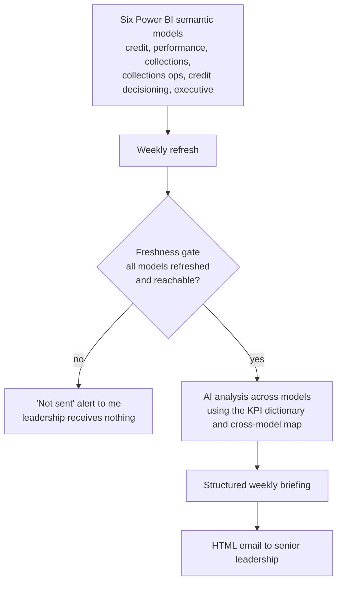

# AI-Assisted Weekly Management Intelligence Report

*An automated weekly briefing for senior leadership, drafted by AI from six Power BI models, and never sent on stale data.*

**Project category:** AI-Enabled Analytics · Business Intelligence · Management Reporting  
**Project status:** Implemented — ran on a weekly schedule in 2026  
**Primary focus:** Turning several separate Power BI reports into one forward-looking weekly briefing with risks, opportunities and recommended actions  
**Professional domain:** Automotive lending and financial services

> This case study describes an AI-assisted reporting workflow I built for the senior leadership of a pan-African automotive finance company. It is written for a public portfolio. The company, report and model names, recipients, KPIs and figures have intentionally been excluded.

## 1. Executive summary

Senior leadership relied on six separate Power BI reports covering credit, portfolio performance, collections, collections operations, credit decisioning and an executive view. Each answered its own question; none told leadership what mattered across the business this week.

I built a weekly management intelligence report that does. Every Monday, after the Power BI models refresh, an AI assistant (Claude) queries all six semantic models, compares the current position with the prior month, and drafts a structured briefing: an executive summary, a management scorecard, KPI detail by business area, emerging risks, opportunities, recommended actions and a short CEO brief. The report is emailed to leadership as formatted HTML.

The key design choice is a **freshness gate**. If the models have not refreshed, or a connection fails, the report is not sent to leadership; I receive a "not sent" alert instead. A briefing built on stale data is worse than no briefing.

The workflow:

**Six Power BI semantic models → model inventory and KPI dictionary → freshness gate → AI analysis across models → structured weekly briefing → HTML email to leadership**

## 2. Business context and problem

Leadership had the data but not the synthesis:
- Six reports had to be opened and read separately to understand the business.
- Connections across areas, such as credit decisions feeding collections risk, were not visible in any single report.
- Reports described the past; leadership wanted a forward view and recommended actions.
- Preparing a cross-business summary by hand every week was time-consuming.
- Some measures were not yet validated, so a summary could repeat a wrong number with confidence.

The goal was one trustworthy weekly briefing that reads across all six reports and tells leadership what to watch and what to do.

## 3. Project objectives

1. Inventory the six semantic models and document what each measures.
2. Build a KPI dictionary and map every KPI to its source model.
3. Design a briefing structure that leadership can read in minutes.
4. Automate the weekly analysis and drafting with an AI assistant.
5. Send the report on a fixed schedule after the data refreshes.
6. Prevent the report from going out on stale or failed data.
7. Make every figure traceable to its source report.

## 4. Scope

### In scope
- Six Power BI semantic models across credit, portfolio performance, collections, collections operations, credit decisioning and executive reporting.
- A model inventory, KPI dictionary, cross-model map, analysis framework and data-quality notes.
- AI-assisted analysis and drafting of the weekly briefing.
- A weekly schedule after the Power BI refresh.
- A freshness gate and failure alert.
- A formatted HTML email to senior leadership.

### Out of scope
- Changes to the underlying Power BI models.
- Predictive models or automated decisions.
- Real-time alerting.

## 5. Data and analytical considerations

| Area | Design consideration |
|---|---|
| Sources | Which six models are in scope, and what does each measure? |
| KPI definitions | Which measure in which model is the agreed source for each KPI? |
| Freshness | How is it confirmed that every model has refreshed before analysis? |
| Comparison basis | What is the current position compared with? (The prior month, as a reference.) |
| Cross-model links | Which KPIs in one area affect another, such as credit quality and collections? |
| Unvalidated measures | How are measures that may be wrong treated in the briefing? |
| Traceability | How does a reader see where each figure came from? |

## 6. Analytical workflow



### 6.1 Foundation: model inventory and KPI dictionary
Before automating anything, I documented each model, built a KPI dictionary, mapped every KPI to its source model, drew a cross-model map of how areas affect one another, and wrote an analysis framework and data-quality notes. This foundation is what the AI works from.

### 6.2 Freshness gate
The workflow runs every Monday morning, after the Power BI refresh. It first checks that every model has refreshed and can be reached. If not, the report is held and I receive a "not sent" alert.

### 6.3 AI analysis across models
The AI assistant queries the semantic models directly, compares the current position with the prior month, and reads across areas using the cross-model map.

### 6.4 Handling unvalidated measures
Some measures returned values that looked mis-scaled. Rather than report them as fact, the briefing labels them "Monitored" until they are validated.

### 6.5 Briefing structure
Every report follows the same structure: an outlook banner, an executive summary, a management scorecard, KPI detail by business area, current-month activity and a forward view, cross-business intelligence, emerging risks, opportunities, recommended actions, what to watch next cycle, a short CEO brief, and a sources section listing where each figure came from.

### 6.6 Delivery
The briefing is sent as a formatted HTML email in the company's brand colours to senior leadership.

## 7. Reporting and KPI framework

The briefing covers KPIs across six business areas. The specific KPIs and values are internal.

| Briefing section | Purpose |
|---|---|
| Executive summary | The week's headline in a few lines |
| Management scorecard | Key KPIs against the prior month |
| KPI detail by business area | What moved in each area, and why |
| Forward view | Where the current month is heading |
| Cross-business intelligence | Links between areas that no single report shows |
| Emerging risks and opportunities | What leadership should watch or act on |
| Recommended actions | Specific next steps |
| CEO brief | The few points that matter most |
| Sources | Where each figure came from |

### Suggested management questions
- What changed across the business this week, and what does it mean?
- Which risks are emerging before they show up in results?
- Where are the opportunities?
- What should we do next, and what should we watch?

## 8. Data quality, validation and reconciliation

1. **Freshness gate:** no report is sent unless every model has refreshed and is reachable.
2. **Single source per KPI:** each KPI is read from the model named in the KPI dictionary.
3. **Monitored measures:** suspected mis-scaled measures are labelled, not reported as fact.
4. **Source listing:** every report lists its sources.
5. **Consistent comparison:** figures are always compared with the prior month.

An AI summary is only as trustworthy as the data and rules underneath it. The gate and the KPI dictionary matter more than the writing.

## 9. Technology and tools

| Technology / capability | Use in this project |
|---|---|
| Power BI semantic models (XMLA) | Source data, queried directly |
| Claude (AI assistant) | Cross-model analysis and drafting of the briefing |
| Scheduled task | Weekly run after the Power BI refresh |
| HTML email | Formatted delivery to leadership |
| Markdown documentation | Model inventory, KPI dictionary, cross-model map, analysis framework |

## 10. My role and contribution

I designed and built the whole workflow:
- Inventoried the six semantic models and documented what each measures.
- Built the KPI dictionary, the KPI-to-source mapping and the cross-model map.
- Wrote the analysis framework and data-quality notes the AI works from.
- Designed the briefing structure.
- Set up the AI assistant's access to the models and the weekly schedule.
- Designed the freshness gate and the failure alert.
- Identified the unvalidated measures and the "Monitored" treatment.

## 11. Business value

- One weekly view across six reports, instead of six separate reads.
- A forward-looking briefing with risks, opportunities and recommended actions.
- Cross-business connections that no single report showed.
- Protection against decisions based on stale data.
- A reusable foundation (inventory, KPI dictionary, cross-model map) for any future reporting.

**Measured impact:** Not yet quantified. No time savings or decision outcomes are claimed.

## 12. Challenges and design risks

- **AI can sound confident about wrong numbers.** The KPI dictionary, single-source rule and "Monitored" label keep the briefing honest.
- **Stale data.** The report depends on the Monday refresh; the freshness gate stops it going out early.
- **Unvalidated measures.** Some model measures returned values that looked mis-scaled and had to be flagged until checked.
- **Reading across reports.** Connecting six reports required a documented map of how the areas relate.

## 13. Limitations and future enhancements

- Validate the "Monitored" measures at source, in the models.
- Add a human review step before sending, for high-stakes weeks.
- Track how leadership uses the briefing, to refine the structure.
- Extend the freshness gate to check data completeness, not only refresh status.

## 14. Reproducibility and public demonstration

A public demonstration is planned using a fictional lending company: sample semantic-model data, a sample KPI dictionary and cross-model map, the briefing template, and a sample output on synthetic data, including the freshness gate's "not sent" path.

```text
ai-weekly-management-report/
├── README.md
├── docs/
│   ├── kpi-dictionary-template.md
│   ├── cross-model-map-template.md
│   └── briefing-structure.md
├── prompts/
│   └── weekly-briefing-prompt.md    # generalised, no company details
├── sample-output/
│   └── example-briefing.html        # synthetic data only
└── .gitignore
```

## 15. Confidentiality and responsible disclosure

This write-up contains no:
- Company, report, model or workspace names.
- Recipients' names or email addresses.
- Actual KPIs, figures or briefing content.
- Credentials, connection details or schedule identifiers.
- Screenshots of company reports.

## 16. Project information confirmed for publication

- [x] Six semantic models across six business areas (generalised).
- [x] Weekly schedule after the Power BI refresh.
- [x] Freshness gate and "not sent" alert.
- [x] Briefing structure.
- [x] "Monitored" treatment of unvalidated measures.
- [x] Publication approved for an anonymised case study.
- [ ] How long the report ran, and how leadership used it.
- [ ] Whether a human reviewed each briefing before it was sent.
- [ ] Measured impact, such as preparation time saved.
- [ ] Public demonstration built and reviewed.

## 17. Conclusion

This project is my clearest step toward AI-enabled analytics. The AI does the reading and drafting; the engineering decides whether it is safe to send. The KPI dictionary, the source rule and the freshness gate are what make an AI briefing something leadership can rely on.

My broader direction is to build dependable data products that connect engineering quality with meaningful business decisions, while deepening my capabilities in advanced analytics, data science and AI/ML engineering.

---

*Portfolio note: This is a sanitised case study. Company names, recipients, KPIs and figures are withheld. Any demonstration data is synthetic.*
